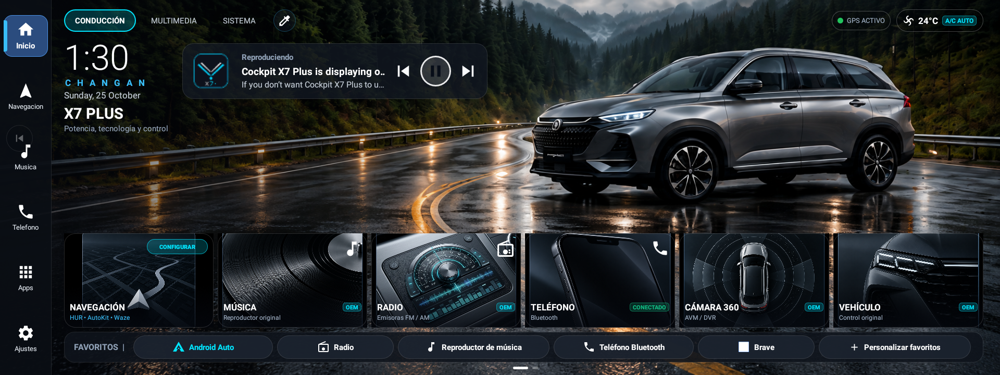
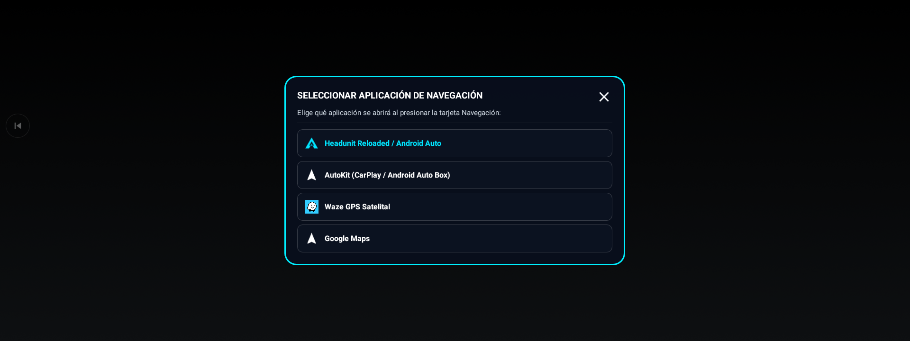
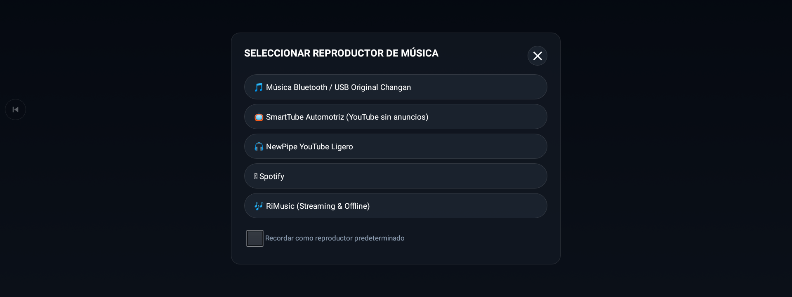
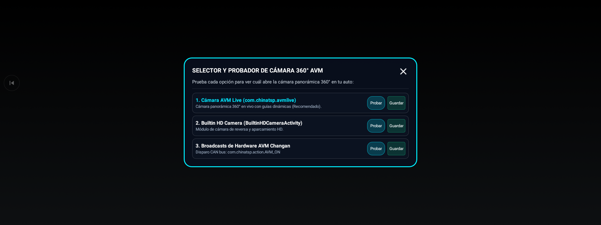
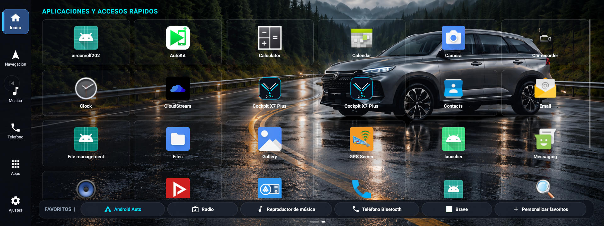
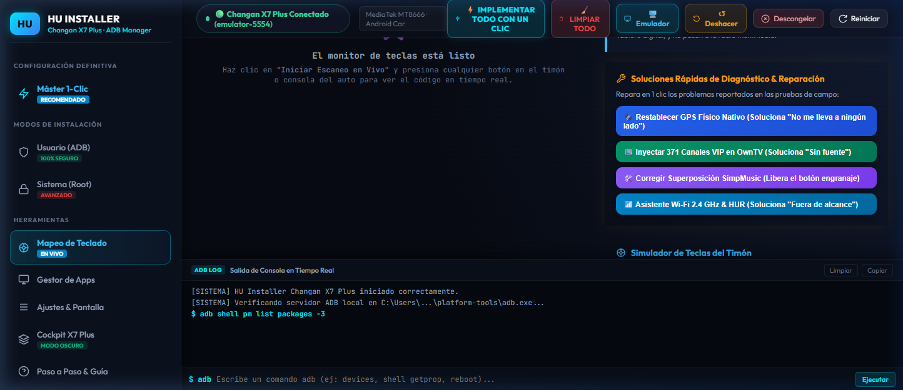

<div align="center">

# 🏎️ Launcher Nativo Changan X7 Plus & Suite Cockpit HMI
### *Lanzador Panorámico (1920x720), Waze, Android Auto Inalámbrico, Música Hi-Fi y Desbloqueo Multimedia para Changan Oshan X7 / X7 Plus*

[](LICENSE)
[](#-filosofía-100-gratuita-y-prohibición-de-venta)
[-yellow.svg)](#-estado-del-proyecto-y-llamado-a-la-comunidad)
[-brightgreen.svg?logo=android)](https://developer.android.com)
[](https://www.mediatek.com)
[-blueviolet.svg)](#características-principales)
[](CONTRIBUTING.md)

<br/>



<br/>
<br/>

> ### 🛑 AVISO IMPORTANTE: PROYECTO 100% PÚBLICO Y GRATUITO
> **Este software, sus herramientas y sus guías son LIBRES y GRATUITAS. Nadie puede cobrarte por el acceso a estos archivos.**  
> **QUEDA ESTRICTAMENTE PROHIBIDA SU VENTA, REVENTA O DISTRIBUCIÓN COMERCIAL POR TERCEROS.**  
> Si alguien te cobró o intentó venderte este paquete, por favor denúncialo. Este es un esfuerzo comunitario sin fines de lucro.

<br/>

[Características](#-características-principales) • [Estado del Proyecto](#-estado-del-proyecto-y-llamado-a-la-comunidad) • [Galería de Fotos](#-galería-de-capturas-y-pruebas) • [Guía de Instalación](#-guía-rápida-de-instalación-en-el-auto) • [Aviso Legal](#-aviso-legal-y-términos-de-uso) • [Comunidad y Soporte](#-comunidad-soporte-y-agradecimientos)

</div>

---

## 📌 ¿Por qué nace este proyecto?

La **Changan Oshan X7 Plus** viene equipada con una pantalla táctil ultra-panorámica de **1920x720 píxeles** y un potente procesador **MediaTek MT8666**. Sin embargo, la interfaz de fábrica (*OnStyle*):
1. No cuenta con tienda libre ni permite instalar aplicaciones con facilidad.
2. Las aplicaciones estándar de Android muestran molestas franjas negras a los lados (formato 16:9 recortado).
3. No posee selectores modernos para alternar entre navegadores GPS (Waze, Maps, Offline) o reproductores de música libre.
4. El acceso al sintonizador nativo de radio y a la cámara de 360° AVM queda rígido o limitado.

**Este proyecto ofrece un Launcher Nativo adaptado al 100% de la pantalla**, junto con una suite portable que se ejecuta desde una laptop mediante cable USB, permitiendo personalizar el vehículo de forma segura, limpia y totalmente reversible.

---

## 🚧 Estado del Proyecto y Llamado a la Comunidad

> [!NOTE]
> ### ⚠️ PROYECTO EN DESARROLLO ACTIVO (NO ESTÁ TERMINADO AL 100%)
> Esta suite es un proyecto vivo y colaborativo. Aunque las funciones principales (Launcher panorámico, modales de tarjetas, audio, Waze, cámaras y scripts de 1 clic) han sido probadas con éxito en el vehículo real, **el proyecto NO está concluido al 100%**.
> 
> Existen diferentes versiones de equipamiento (Comfort, Elite, Luxury) y actualizaciones de firmware de Changan en distintos países.
> 
> **¡Tus aportes son sumamente bienvenidos!**  
> Si tienes conocimientos en Android, diseño de interfaces, ingeniería inversa o simplemente quieres compartir los códigos de botones del timón de tu versión, revisa nuestra [Guía de Contribución (CONTRIBUTING.md)](CONTRIBUTING.md) o abre un *Issue* en este repositorio.

---

## ✨ Características Principales

### 🖥️ 1. Launcher Nativo Cockpit Ultra-Panorámico (1920x720)
* **Bypass de Bordes Negros:** Llena el 100% del cristal panorámico sin barras negras laterales.
* **Tarjeta de Radio Digital AM/FM:** Gráfico automotriz con ecualizador neón (`#00E5FF`) totalmente diferenciado del reproductor de música.
* **Tarjeta de Música Hi-Fi:** Disco de vinilo clásico en tonos dorados.
* **Dock Inferior Rápido:** Acceso inmediato a Navegación, Música, Apps, Ajustes del auto y Home.

### 🧭 2. Selector Dinámico de Navegación GPS
* Modal panorámico de tarjetas interactivas:
  * **Waze GPS:** Alertas de tráfico en tiempo real.
  * **Google Maps:** Navegación estándar y satelital.
  * **Magic Earth / Organic Maps:** Navegación GPS satelital **100% Offline** aprovechando la antena de hardware nativa del auto (sin gastar megas del celular).
  * **HeadUnit Reloaded (HUR):** Android Auto inalámbrico o por cable.

### 🎵 3. Música Libre y Audio Hi-Fi
* **SimpMusic & ViMusic:** Reproductores libres sin anuncios, con soporte para descargar canciones y escucharlas sin conexión en carretera.
* **Spotube:** Cliente ligero para reproducción y descargas locales.
* **Radio OEM Nativa:** Acceso directo al sintonizador original Changan (`com.edog.car.changanoushang`).

### 📺 4. Televisión en Vivo y Streaming
* Integración con OwnTV y lista local M3U de **más de 370 canales de señal abierta y cable de Perú y Latinoamérica**.
* SmartTube 4K (YouTube sin interrupciones publicitarias) y navegador ligero Brave.

### 🕹️ 5. Mapeador de Teclas del Timón y Cámara 360°
* Captura de eventos Linux (`getevent`) y Android (`KeyEvent`) con latencia ultra-baja (<50 ms).
* Acceso directo a la cámara 360° AVM oficial mediante Intent automotriz (`com.chinatsp.avmlive`).

### 🛡️ 6. Botón de Deshacer en 1 Clic (Rollback de Fábrica)
* **Tranquilidad Total:** Si deseas dejar el vehículo tal y como vino de fábrica, basta con presionar `↺ Deshacer Cambios y Volver a OnStyle`.
* Purga la caché de OnStyle para evitar iconos vacíos o "apps fantasma".

---

## 📸 Galería de Capturas y Pruebas

<div align="center">

### Interfaz del Launcher y Modales Panorámicos
| Launcher Nativo Principal (1920x720) | Selector de Navegación GPS |
| :---: | :---: |
|  |  |

| Selector de Música Hi-Fi | Selector de Cámaras 360° AVM |
| :---: | :---: |
|  |  |

| Cajón de Aplicaciones Nativo | Dashboard Web de Control |
| :---: | :---: |
|  |  |

</div>

---

## 🚀 Guía Rápida de Instalación en el Auto

No necesitas instalar programas complejos ni variables de entorno. Todo funciona mediante scripts automatizados:

### Paso 1: Activar Depuración por USB en el Auto
1. Enciende la radio de tu Changan X7 Plus.
2. Abre la aplicación de **Teléfono** (marcador numérico).
3. Digita exactamente el código:
   ```text
   **888
   ```
4. Se abrirán los Ajustes Ocultos de Desarrollador. Marca la casilla **Depuración por USB**.
5. Conecta tu laptop al **puerto USB frontal** del vehículo usando un cable de datos USB de buena calidad.
6. En la pantalla de la radio, marca la casilla *"Permitir siempre desde este equipo"* y presiona **Aceptar**.

### Paso 2: Ejecutar los Scripts en tu Laptop
Elige la opción que prefieras en tu laptop:

* **Opción A (Recomendada - Dashboard Visual Web):**
  Doble clic en `INICIAR_DASHBOARD_CHANGAN.bat`. Abrirá tu navegador en `http://localhost:5050` con el simulador en vivo y el botón `⚡ IMPLEMENTAR TODO CON UN CLIC`.
* **Opción B (Menú Maestro por Consola):**
  Doble clic en `0_ABRIR_MENU_CHANGAN.bat` para acceder a todas las opciones (emulador, mapeo de timón, pruebas de cámara, instalación y desinstalación).
* **Opción C (Instalación Directa Silenciosa):**
  Doble clic en `INSTALAR_TODO_EN_EL_AUTO.bat`.

---

## ⚖️ Aviso Legal y Términos de Uso

> [!CAUTION]
> ### 📜 TÉRMINOS LEGALES Y DESCARGO DE RESPONSABILIDAD
> 1. **Proyecto Independiente:** Este proyecto no está patrocinado, aprobado, afiliado ni respaldado oficialmente por *Changan Automobile Co., Ltd.* ni por sus concesionarios autorizados. Todas las marcas registradas, logotipos y nombres de vehículos pertenecen a sus respectivos propietarios.
> 2. **Finalidad Educativa y Libre:** El código, las guías y los scripts se proporcionan bajo la [Licencia MIT](LICENSE) exclusivamente con fines educativos, de personalización y para la comunidad automotriz de código abierto.
> 3. **Prohibición Estricta de Comercialización:** Ninguna persona, negocio o entidad tiene autorización para vender, revender o cobrar por este paquete de archivos. El uso de este repositorio es 100% público y gratuito.
> 4. **Responsabilidad del Usuario:** Aunque los métodos empleados son no destructivos y cuentan con reversión segura a la interfaz de fábrica, la aplicación de estos cambios se realiza bajo el criterio y responsabilidad exclusiva de cada propietario.

---

<br/>

<div align="center">

## 🌐 Comunidad, Soporte y Agradecimientos

Este proyecto es impulsado con entusiasmo para la comunidad Changan con el respaldo técnico y difusión de:

<br/>

<a href="https://cdkeysperu.com" target="_blank">
  
</a>

<br/>

### [👉 Visita CDKeys Perú (cdkeysperu.com)](https://cdkeysperu.com)
*Tienda tecnológica especializada en licencias de software original (Windows 11, Microsoft Office, Antivirus) y soporte en Perú.*

---

### 🎁 Filosofía 100% Gratuita
El acceso a este repositorio y a todas sus herramientas es y seguirá siendo **completamente libre y público**. No es obligatorio ningún pago para utilizarlo.

---

### 🛠️ ¿Tienes dudas técnicas o prefieres ayuda con la instalación?
Entendemos que no todos los usuarios tienen experiencia conectando computadoras al auto mediante ADB o ejecutando comandos técnicos.

Si prefieres no complicarte y deseas que **un técnico te guíe paso a paso o te asista remotamente en la instalación**, se puede coordinar apoyo personalizado por un **costo simbólico** destinado a cubrir el tiempo de asistencia y seguir financiando el desarrollo de la suite:

* **Consultas y asistencia guiada:** Contáctanos a través de [cdkeysperu.com](https://cdkeysperu.com) o mediante los canales de atención en la web.  
*(Nota: La asistencia técnica es opcional; tú mismo puedes realizar todo el proceso gratis con las guías de este repositorio).*

---

### ☕ Donaciones Voluntarias (Sin Ningún Compromiso)
Si esta suite te ha sido útil, te ha permitido disfrutar más de tu vehículo o deseas colaborar voluntariamente con los costos de desarrollo:

<br/>

| 🇵🇪 Yape / Plin (Perú) | 🌎 PayPal (Internacional) |
| :---: | :---: |
| <br/><sub>Escanea con Yape / Plin</sub> | <br/><br/><a href="https://paypal.me/axelnn51" target="_blank"></a><br/><br/>[👉 **paypal.me/axelnn51**](https://paypal.me/axelnn51)<br/><sub>(Cuenta: axelnn51@gmail.com)</sub> |

<br/>

*¡Cualquier aporte voluntario es recibido con enorme gratitud, pero nunca es obligatorio!*

---

<p align="center">
  <sub>Desarrollado con pasión para toda la comunidad de propietarios Changan Oshan X7 Plus.</sub>
</p>

</div>
